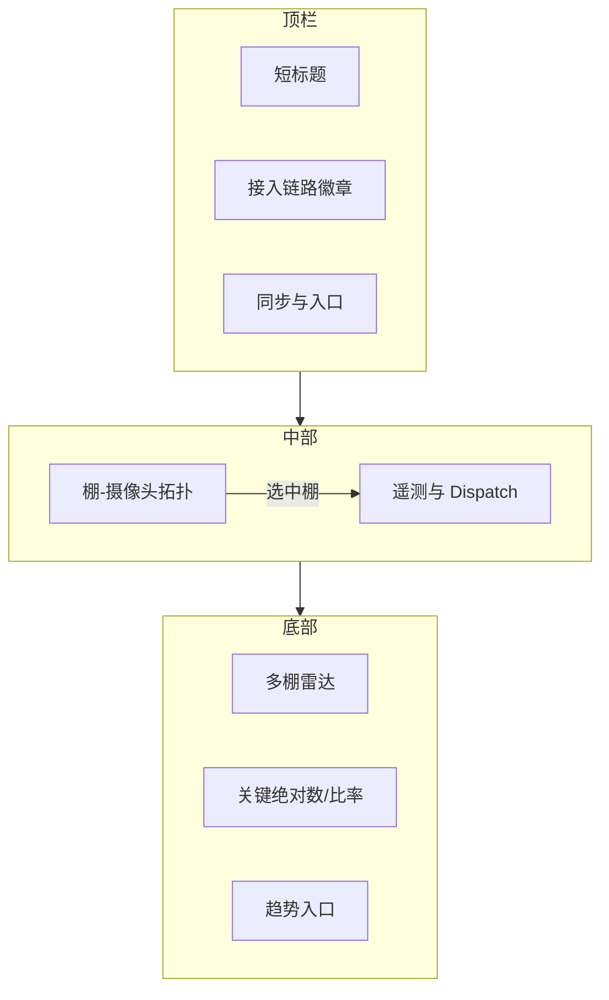

# 蘑菇检测展示大屏 · Discovery 风格静态 UI 方案

> 状态：静态方案（未实现代码）  
> 对照对象：现有 `apps/web/src/views/BigScreenView.vue`（路由 `/big-screen`，标题「基地大屏」）  
> 能力边界：仅引用 `docs/CURRENT_CAPABILITIES.md` 与现有大屏/总览已接线的实体与接口  
> 参考视觉：用户提供的 Stanford AI Lab「Discovery Architecture」深色高密度终端图（仅作审美参考，**不**宣称本产品具备该实验室的发现栈）

---

## 1. 目的

做一版**演示 / 对外展示**用的大屏视觉方案：把参考图里的「深色发现式终端」密度与分区，映射到蘑菇平台**已有**的棚、摄像头、识别、告警、环境、趋势数据上。

本方案**不替代**现有运营大屏。两页分工：

| 角色 | 路由（现状 / 建议） | 用途 |
|------|---------------------|------|
| 运营日常 | `/big-screen`（已有） | 指挥 / 抓拍墙 / 多区；值班扫读、点棚、处置入口 |
| 演示冲击 | 建议独立路由，如 `/big-screen/discovery` 或 `/showcase`（**未实现**） | 展厅 / 汇报；高密度视觉，短标签，少操作 |

验收口径：方案能对照现有大屏逐区说清「看什么、数据从哪来、哪块是视觉占位」。先定方案，再切片实现。

---

## 2. 现有大屏（事实摘要）

来源：`BigScreenView.vue` + `docs/CURRENT_CAPABILITIES.md`「总览与大屏」节。

### 2.1 路由与壳

- 路由：`/big-screen`，`meta.title = 基地大屏`；在管理端壳**之外**全屏。
- 根节点固定 `data-skin="tb-night"`（夜蓝底 `#0b1e33`）；另有 `skin` 浅/暗切换（暗色为绿夜皮肤）。
- 布局三态：`command`（默认）、`wall`（抓拍墙）、`panels`（多区 + 底部时间轴图）。
- 轮询：`REFRESH_MS = 30_000`。

### 2.2 分区与数据

| 区 | 内容 | 接口 |
|----|------|------|
| 顶栏 | 「基地大屏」、时钟、同步文案、用户角色、布局切换、皮肤、回管理端 | — |
| 指标条 | 棚区数、设备在线、今日成熟、未关闭告警（可带严重数） | `GET /dashboard/overview`（辅以本地告警/设备列表） |
| 左 · 棚区平面 | `mapX`/`mapY` 点位；色调按未关闭告警 + 在线 | `GET /sheds` + alerts/devices |
| 中 · 抓拍墙 | 识别记录缩略图：摄像头、棚、成熟/病害计数 | `GET /ingest/recognitions` |
| 右 · 告警 / 环境 / 设备 | 告警列表；温度湿度 CO₂ 基质含水；设备在线与心跳 | alerts；overview.env 或选棚最近识别上的环境字段；devices |
| 底 · 时间轴入口 + 滚动条 | 7 日 / 24 小时链到趋势；`panels` 时画 ECharts；滚动告警+识别 | `GET /growth-trends` 或 `/growth-trends/hours` |

### 2.3 视觉气质（现状）

- 卡片圆角、分区边框、可读优先；tb-night 为深蓝运营台，不是霓虹终端。
- 标签口语短（棚区、抓拍墙、告警），无空洞 slogan。
- 种子规模约三棚；`facts.json` 记载更大部署，**当前库与样张不是该规模**（能力文档已写明）。

### 2.4 总览对照（非大屏，但同属运营台）

`/` `DashboardView`：浅色/运营台 `tb-ops`——棚区平面、棚表、温度图、近 7 日趋势。与大屏同属「日常运营」，演示 Discovery 页应与二者**并存**，不要改坏现有值班路径。

---

## 3. 方案分区映射

把参考图四区映射到蘑菇实体。凡产品没有对应数据的，标 **视觉占位** 或 **需新增 / 二期**，不写成已有能力。

### 3.1 映射总表

| Discovery 参考区 | 蘑菇含义 | 数据来源（已有） | 备注 |
|------------------|----------|------------------|------|
| 顶栏标题 + Agent Cognitive Stack | 产品名短标 + 「接入链路」阶段徽章 | 文案静态；阶段高亮可来自 `GET /ingest/observability`（大屏**尚未**调用，产品页 `/ingest-observability` 已有） | 勿写 Stanford / ITERATIONS / LLM |
| 顶栏 pipeline badges | 真实管线步骤（见下） | 能力文档接入表 + 桶写路径 + 告警 | 只列真实阶段名 |
| 中央 3D 环状拓扑 | **棚 ↔ 摄像头**关系，边表示近窗有识别/心跳 | `sheds` + `devices`（摄像头）+ 近窗 `recognitions` | 真 3D torus 网格为 **视觉占位**；首版可用 2D 力导向 / 环形图表达同一关系 |
| 中央 callout | 选中棚或摄像头：成熟/病害/在线 | overview 分棚无单独拓扑 API；用选中实体 + 识别/告警聚合 | 标签如 `S01`、`cam-…`、`成熟 n`，禁止假 `CANDIDATE id` / `SOPA` |
| 右侧波形 / 频谱 | 近窗识别量、拒收、延迟（示意波形） | observability 的 received / rejected / latency；或识别列表按时间分桶 **视觉占位波形** | 无真 GPU 效率；勿标 EFFICIENCY/DIVERSITY 空指标 |
| 右侧 CYCLE STATE / HEARTBEAT | 同步状态 + 设备心跳摘要 | 大屏已有 `syncLabel`；devices `lastSeenAt` / online | 文案用「同步 / 在线 n/m」，勿抄 SYNCHRONIZING |
| 右侧 DISPATCH LOG | 最近告警 + 最近识别一行流 | alerts + recognitions（现有 ticker 同源） | 短行：`严重 · S02 · 标题` / `识别 · S01/cam · 成熟` |
| 底部雷达 | 多棚对比轴：蘑菇数、成熟、病害、在线率等 | `growth-trends` 棚级点；devices 在线；diseases/桶若接入 | 轴名必须对应已有字段；缺数显示「—」 |
| 底部滑条 / 分数条 | 单棚或全场：今日成熟、未关告警、设备在线率、环境是否在阈值内 | overview + alert-rules 阈值（总览已用规则画温度线；大屏未直接拉 rules） | 百分比仅在可定义公式时给出，否则绝对数 |
| 底部 Pareto | 病害 vs 成熟（或产量代理）权衡 | 日桶有病害数、成熟数（报表/趋势同源） | **二期**：首版可不做曲线，或标 **视觉占位**；不做「失败率降低」假叙事 |

### 3.2 顶栏管线徽章（仅真实阶段）

建议从左到右（短标签，大写或中英择一并保持安静）：

1. `HTTP/MQTT` — 接入通道  
2. `校验` — 契约 / 拒收  
3. `识别入库` — `recognition_records`  
4. `写桶` — 小时/日 `metric_buckets_*`  
5. `告警` — 阈值触发与未关闭  
6. `抓拍` — MinIO 对象（可失败仍入库）  
7. `报表` — 预览/导出（演示可灰显为「可进」而非实时态）

高亮规则（实现时）：例如近窗 `rejected>0` 时「校验」偏暖色；`openAlerts>0` 时「告警」偏暖色。**不**发明 `map_elites` / `onnx.search_plan` 等与产品无关的徽章。

### 3.3 中央拓扑（推荐语义）

优先实体（与能力文档一致）：

- 节点：棚（`sheds`）、摄像头设备（`devices` type 摄像头）  
- 边：该摄像头在近窗识别列表中出现 → 棚–摄像头连线；可选设备离线虚线  
- 交互：点击棚 → 右侧与 callout 过滤到该棚（对齐现有 `selectedCode`）

**不要**把中央画成「神经元搜索解空间」或「候选解 id-8432」。本仓不做图像识别与模型训练，只收边缘侧结果。

3D torus：若演示需要冲击力，可用静态/慢旋 **视觉占位** 网格，节点锚在真实棚/摄像头坐标投影上；评审时必须能关掉占位只留 2D 关系图。

---

## 4. 对照：现有大屏 vs 本方案

| 维度 | 现有 `/big-screen` | Discovery 展示方案 |
|------|--------------------|--------------------|
| 定位 | 基地值班 / 运营指挥 | 展厅演示 / 对外冲击 |
| 气质 | tb-night 深蓝运营台；可选绿夜；卡片清晰 | 更深黑底 + 电蓝/橙点缀；细线高密度；短标签 |
| 中央 | 抓拍墙（证据画面） | 棚–摄像头拓扑（关系）；抓拍改侧栏缩略或次屏 |
| 顶区 | 标题 + 布局切换 | 接入链路徽章 + 同步；布局切换可收进「演示/运营」入口 |
| 右侧 | 告警 / 环境四格 / 设备列表 | 遥测数字 + 一行 dispatch；环境可缩成四火花线 |
| 底区 | 时间轴入口 + 滚动 ticker | 多棚雷达 +（可选）桶对比条；ticker 可并入 dispatch |
| 操作 | 点棚、钉抓拍、切 7 日/24h、回管理端 | 演示以只读为主；保留回 `/big-screen` |
| 诚实边界 | 已按失败分区显示 zoneError | 同样禁止空表假绿；无数据写「暂无」 |

两页都保留：现有页继续服务生产值班；新页不默认替换侧栏「基地大屏」链，或侧栏增加「展示大屏」需用户拍板。

---

## 5. 线框（约 1280×800 密度）

```text
┌──────────────────────────────────────────────────────────────────────────────┐
│ 蘑菇 · 展示大屏     HTTP/MQTT · 校验 · 识别 · 写桶 · 告警 · 抓拍 · 报表      │
│ 2026-10-10 10:09   更新 10:09 · 30s          [运营大屏] [只读]               │
├────────────指标条：棚 n │ 在线 a/b │ 今日成熟 n │ 未关告警 n（严重 m）────────┤
│                         │                                      │             │
│   ┌─ callout ─┐         │     中央：棚–摄像头环形/力导向        │  同步       │
│   │ S01 成熟… │         │     （3D 环 = 视觉占位可选）          │  在线 a/b   │
│   └───────────┘         │     节点=棚/摄像头 边=近窗识别         │  近窗识别   │
│                         │                                      │  拒收       │
│                         │                                      │  延迟 p50   │
│                         │                                      │  ─────────  │
│                         │                                      │  DISPATCH   │
│                         │                                      │  告警/识别  │
│                         │                                      │  一行流     │
├─────────────────────────┴──────────────────────────────────────┴─────────────┤
│ 雷达：多棚 蘑菇/成熟/病害/在线   │  条：成熟·告警·在线率   │ 趋势入口 7日/24h │
└──────────────────────────────────────────────────────────────────────────────┘
```



密度注意：

- 1280 宽：中央不少于约 55% 宽；右侧约 280–320px；底高约 140–180px。  
- 字号：标题 ≤ 18–22px；徽章与日志 11–12px；忌大字 slogan。  
- 与现有大屏相同：分区失败各自报错，不因一块失败清空全屏。

---

## 6. 视觉 token（建议）

| Token | 建议值 | 说明 |
|-------|--------|------|
| `--bg-void` | `#05080c` | 深于现有 tb-night，拉开「展示」与「运营」 |
| `--bg-panel` | `#0a1218` | 面板 |
| `--line` | `#1a2a38` | 1px 细线 |
| `--neon-blue` | `#00aaff` | 拓扑边、选中 | 
| `--neon-orange` | `#ff8800` | 告警 / 校验拒收强调 |
| `--neon-green` | `#6fce8a` | 可对齐现有 tb-night 数值绿，表「正常」 |
| `--text` | `#e7eef6` | 主字 |
| `--text-dim` | `#8aa0b5` | 次字 |
| 字体 | 现有栈 + 等宽用于数字/日志 | 保持安静；全大写仅用于徽章 |

动效：拓扑慢移、dispatch 上滚即可；禁止炫光循环干扰读数。

文案禁忌：不出现「智能发现引擎」「认知栈」「科学发现」等空洞标题；产品能力是接入、告警、大屏、台账（见能力文档定位）。

---

## 7. 非目标

- 不宣称 Stanford / Discovery Architecture 产品能力。  
- 不引入 Timescale 专用发现栈、LLM 摘要、自动周报（能力文档「未做」）。  
- 不伪造 GPU、候选解 id、帕累托「失败率」叙事。  
- 不在本任务实现完整 Vue 页；不改坏 `/big-screen` 值班行为。  
- 不把 `docs/指挥台需求草稿.md`（项目进度小应用）与本展示大屏混为一谈。

---

## 8. 后续实现切片 · 验收（第一 PR 可完成的定义）

建议第一刀（静态/半静态即可）：

1. **新路由**只读页（如 `/showcase`），侧栏或大屏顶栏链过去；默认仍进现有 `/big-screen`。  
2. **同一批已有 API**（overview / sheds / devices / alerts / recognitions；可选 observability），30s 刷新逻辑可复用。  
3. **四区骨架**：顶徽章（静态阶段名 + 可选 observability 高亮）、中央 2D 棚–摄像头图、右遥测+dispatch、底多棚雷达或简明条（数据不足显示「—」）。  
4. **3D torus、Pareto 曲线**若不做：文档与 UI 标「视觉占位 / 二期」，或根本不渲染。  
5. **对比说明**进 `docs/ui/`（本文），PR 描述写清与运营大屏并存。  
6. 测试：路由注册 + 无数据/分区失败不空白假绿（对齐现有大屏 zoneError 精神）。

超出第一刀：真 3D、告警规则驱动的环境「滑条」、Pareto、替换侧栏默认大屏——需另开需求与用户拍板。

---

## 9. 待用户拍板

1. 新页路由名与侧栏是否增加「展示大屏」。  
2. 中央首版：仅 2D 关系图，还是允许 3D **视觉占位**。  
3. 底部：雷达用哪些轴（建议：蘑菇数、成熟、病害、在线率）；Pareto 是否二期。  
4. 是否在展示页调用 `GET /ingest/observability`（产品已有，大屏未用）。

---

## 10. 依据文件

- `docs/CURRENT_CAPABILITIES.md` — 定位、接入、大屏、趋势、告警、诚实边界  
- `apps/web/src/views/BigScreenView.vue` — 现网大屏结构与皮肤  
- `apps/web/src/router.big-screen.spec.ts` — 路由与侧栏「基地大屏」  
- `apps/web/src/views/DashboardView.vue` — 运营总览气质对照  
- `apps/web/src/views/IngestObservabilityView.vue` — 接入观测字段  
- `docs/evidence/monitor-batch/` — 抓拍墙演示静帧（非生产实拍）

*方案正文结束。*
